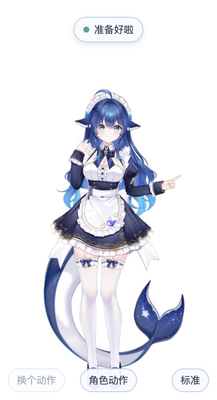
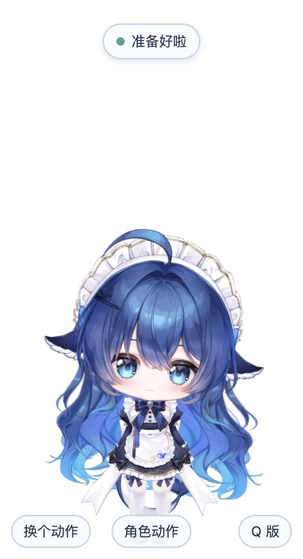
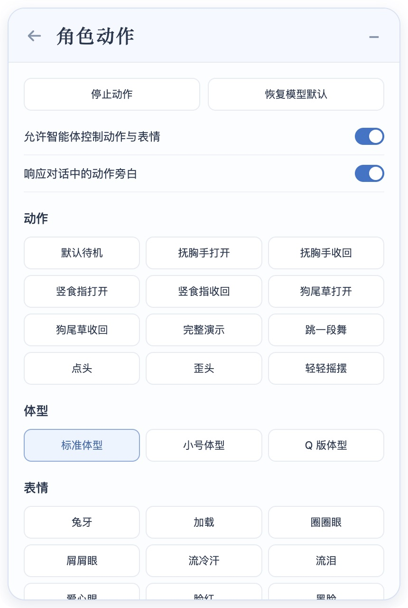

# 鲸鱼娘桌宠

鲸鱼娘桌宠让一只 Live2D 鲸鱼娘陪你待在桌面上。通过快捷面板，你可以使用真实的 DeepSeek Harness（DSH）会话和工作区；智能体也可以用气泡、动作和表情与你互动。

Companion **0.1.0** 是源码预览版本，基于 DSH **0.2.2-alpha.2**。目前没有发布安装包；本版本已在 macOS Apple Silicon 上进行本地源码构建与部分交互验证，Windows 和 x64 尚未验收。

## 版本

| 组件 | 当前版本或来源 |
| --- | --- |
| Companion | 0.1.0（源码预览） |
| DeepSeek Harness | 0.2.2-alpha.2 |
| Electron | 44.7.0 |
| PixiJS | 7.4.3 |
| pixi-live2d-display-lipsyncpatch | 0.5.0-ls-8 |
| Live2D Cubism Core | 5.1.0 本机实测；需自行取得 |
| 鲸鱼娘人设 | [上游参考提交](https://github.com/linsport/dsh-whale-persona/commit/4f884899df629b88c331e96151225dc825c15c96)的本地适配 |
| dsh-mnemon / Mnemon CLI | 0.5.37 / 0.2.13 |

## 使用效果

<table>
  <tr><th>标准体型</th><th>Q 版体型</th></tr>
  <tr><td></td><td></td></tr>
</table>

*截图来自同一实现的本地运行。*

<details>
<summary>查看动作与表情控制面板</summary>



</details>

- **桌面角色**：三种体型、23 项表情和外观，包含模型自带的 8 个动作和本地编排的点头、歪头、摇摆、舞蹈。
- **快捷聊天**：连接真实 DSH Session 和 Workspace，发送消息、阅读 Markdown 回复，关闭面板后也可重新打开最近回复。
- **气泡互动**：智能体可用 `whale_actions` 控制角色，也可用 `talk_to_owner` 显示最多 60 个字符的气泡，并配合八种情绪对应的动作、表情和口型。口型按文字进度驱动，当前没有 TTS 语音；详细内容仍显示在会话中。
- **未读与提醒**：桌宠消息保存在本地未读队列中。已显示或已排队的回执均不代表用户已读。后台定时任务新建会话后投递消息的路径已实测；循环任务可以使用相同工具，但尚未单独完成循环运行验收。
- **长期记忆**：本地 dsh-mnemon 支持跨会话关键词召回；当前没有启用 embedding。
- **桌面偏好**：可调整自动待机舞蹈、减弱动态、安静时段和可选的全局快捷键。渲染上限为 60 FPS，实际帧率取决于运行环境。

## 准备

你需要 Git、Node.js **24.9.0 或更高版本**、pnpm **11.28.5**，以及网络连接。首次准备会下载 DSH 源码及依赖，下载量较大；构建也需要一定时间和磁盘空间。

请自行从[模型原商品页面](https://vgen.co/KAMIYA/product/deepseek-chan-deepseek-free-live2d-model-layered-psd-psd/1c55a71a-2747-4616-819d-2dc0a934089d)取得并解压模型原包，同时从 [Live2D Cubism SDK for Web 官方下载页](https://www.live2d.com/en/sdk/download/web/)自行取得支持 Cubism 5 的 Cubism Core JavaScript 文件。Core 5.1.0 是本机实测版本，脚本不会自动安装 Core，也未验证所有 SDK 版本；使用 Core 前请阅读 [Live2D Cubism SDK 许可](https://www.live2d.com/en/sdk/license/)。

模型原包条款禁止重新上传完整模型，允许展示和制作衍生视频并要求署名。其他使用条件以原包条款为准。本仓库不包含 moc3、纹理、PSD、原动作文件或 Cubism Core；这些素材和专有组件不受本项目代码的 MIT 许可授权。

## 从源码运行

克隆仓库并执行以下命令。将导入命令中的两个路径替换为你本机的解压模型目录和 Core 文件；模型目录应直接包含 `大肥鱼.model3.json` 等原包文件。

```sh
git clone https://github.com/Yifan-Chang-Jerry/dsh-whale-companion.git
cd dsh-whale-companion
pnpm setup
pnpm import-model --model /path/to/extracted/model --core /path/to/Core/live2dcubismcore.min.js
pnpm build
pnpm start
```

`setup` 会获取固定提交的公开 DSH 源码、应用本仓库补丁和覆盖文件，再安装锁定依赖；导入脚本会把用户自行取得的资源复制到本地运行目录并生成动作配置。请使用 `pnpm start` 启动，构建过程中生成的 `.app` 不是本项目发布的安装包。

首次启动用于初始化桌面环境。首次使用模型前，需要在欢迎界面登录，或按提示配置模型提供商的 API Key。随后用 **Cmd+Q** 完全退出应用，再安装桌宠智能体组件并重新启动：

```sh
pnpm install-agent
pnpm start
```

新建会话时选择鲸鱼娘预设，再从快捷面板绑定会话和工作区。新目录中已验证组件安装和桌面启动；快捷面板绑定曾在之前的本地版本实测，新目录尚未配置密钥，也未完成真实模型会话验收。

运行数据保存在本仓库的 `.runtime/data`，该目录已排除在 Git 外。准备过程不会复制已有的用户配置、会话或记忆。密钥由你自行在工作台配置，请勿提交密钥或本地运行数据。

如果只想启动 DSH 桌面界面而隐藏桌宠，可以运行：

```sh
DSH_COMPANION_ENABLED=0 pnpm start
```

## 开发与验证

```sh
pnpm build
pnpm check
```

`build` 构建 DSH 产物并检查构建消费者；`check` 运行桌宠、Session 集成和构建相关的定向测试。本版本已完成构建检查，以及 8 个测试文件的 211 项测试；它们不等同于所有平台和所有界面交互的验收。

本仓库以轻量源码覆盖层接入 DSH，并沿用 DSH 原有的 Host 和会话能力：

- `overlay/`：桌宠新增源文件。
- `patches/dsh-companion.patch`：对固定 DSH 版本的集成修改。
- `bundles/`：角色人设和记忆配置。
- `scripts/`：源码准备、模型导入、构建、启动和检查脚本。
- `config/`：上游版本和本地配置。
- `.runtime/`：本地生成的源码、依赖、模型资源和用户数据，不提交到仓库。

DSH 固定提交为 [`ce7073d51254c26cd63b22a60835b8f948deb447`](https://github.com/deepseek-ai/deepseek-harness/commit/ce7073d51254c26cd63b22a60835b8f948deb447)。

## 鸣谢与许可

- Live2D 模型：[DeepSeek-chan / DeepSeek Free Live2D Model + Layered PSD](https://vgen.co/KAMIYA/product/deepseek-chan-deepseek-free-live2d-model-layered-psd-psd/1c55a71a-2747-4616-819d-2dc0a934089d)。[Kamiya Ryoko](https://vgen.co/KAMIYA) 绘画、拆分及发布（[X](https://x.com/kamiya_ryoko)）；[霓虹猫_NeonNeko](https://www.live2d.com/en/creator/neonneko-studio/) 进行 Live2D 绑定。
- 角色人设基于 [linsport/dsh-whale-persona](https://github.com/linsport/dsh-whale-persona) 本地适配，参考提交 [`4f884899df629b88c331e96151225dc825c15c96`](https://github.com/linsport/dsh-whale-persona/commit/4f884899df629b88c331e96151225dc825c15c96)。其完整许可及角色形象的非 MIT 说明保留在 [bundles/whale-persona/LICENSE](bundles/whale-persona/LICENSE)。
- Live2D 渲染使用 Rasan147 的 [pixi-live2d-display-lipsyncpatch](https://github.com/RaSan147/pixi-live2d-display) 0.5.0-ls-8，基于 Guan 的 [pixi-live2d-display](https://github.com/guansss/pixi-live2d-display)。
- [Live2D Cubism Web Framework](https://github.com/Live2D/CubismWebFramework) 由 Live2D Inc. 提供，适用 [Live2D Open Software License](https://github.com/Live2D/CubismWebFramework/blob/develop/LICENSE.md)，与 Cubism Core 的专有许可分别适用。
- 品牌字体 [Montserrat](https://github.com/JulietaUla/Montserrat) 由 The Montserrat.Git Project Authors 创作，采用 SIL Open Font License 1.1；许可见 [licenses/Montserrat-OFL.txt](licenses/Montserrat-OFL.txt)。
- 记忆使用 [dsh-mnemon](https://github.com/omdsh-dev/dsh-mnemon) 0.5.37 和 [Mnemon CLI](https://github.com/mnemon-dev/mnemon)（`@mnemon-dev/mnemon`）0.2.13。
- 桌面基础使用 [DeepSeek Harness](https://github.com/deepseek-ai/deepseek-harness)、[Electron](https://github.com/electron/electron)（Electron Community）、[PixiJS](https://github.com/pixijs/pixijs)（Mat Groves 和贡献者）、[React](https://github.com/facebook/react)（React 团队）、[Zod](https://github.com/colinhacks/zod)（Colin McDonnell）及 [Marked](https://github.com/markedjs/marked)（Christopher Jeffrey 和贡献者）。

本项目原创代码按 [MIT 许可证](LICENSE)发布；DSH 的原始许可见 [licenses/deepseek-harness-MIT.txt](licenses/deepseek-harness-MIT.txt)。第三方版权与许可见 [THIRD_PARTY_NOTICES.md](THIRD_PARTY_NOTICES.md) 和[完整依赖与许可资料](third-party/README.md)。模型、角色形象和 Cubism Core 的权利与代码许可分别处理。
